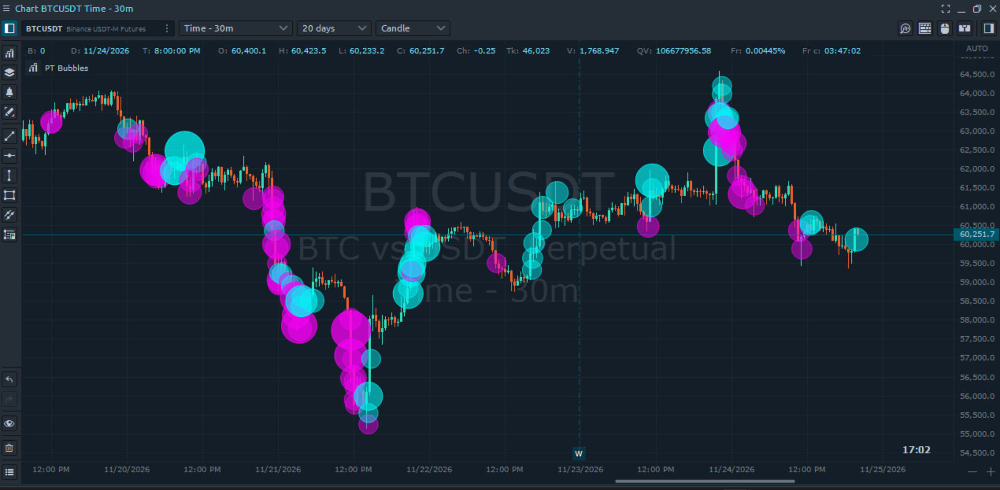
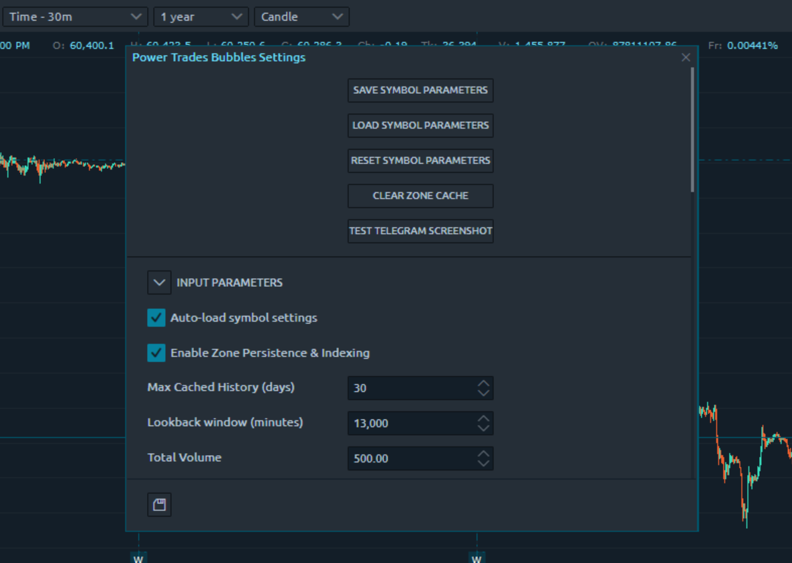
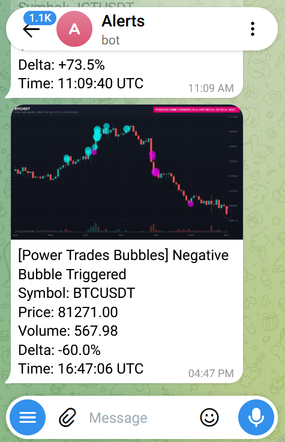

# Volume Delta Bubbles Indicator

A high-performance [Quantower](https://www.quantower.com/) chart indicator that renders a **bubble at every Volume Delta zone** — Quantower's large-aggressive-order detector. Bubble size encodes combined cumulative zone volume and directional skew; color encodes buy vs. sell dominance. Includes real-time sound alerts, Telegram screenshot delivery, and persistent zone caching.


---

## Table of Contents

- [Features](#features)
- [Screenshots](#screenshots)
- [Requirements](#requirements)
- [Installation](#installation)
- [Configuration](#configuration)
- [Alert Modes](#alert-modes)
- [Architecture](#architecture)
- [Building from Source](#building-from-source)
- [Contributing](#contributing)
- [License](#license)

---

## Features

| Feature | Description |
|---|---|
| **Real-time bubbles** | Renders on the **forming candle** immediately — no waiting for bar close |
| **Sized by volume** | Bubble diameter scales with `Cumulative × \|Δ%\| / 100` or raw cumulative volume (configurable) |
| **Color-coded direction** | Cyan = buy-dominant, Magenta = sell-dominant (fully customisable) |
| **Sound alerts** | MP3 playback via [NAudio](https://github.com/naudio/NAudio) — zero ThreadPool blocking, overlap-safe |
| **Native Quantower alerts** | Fires into Quantower's built-in alert panel |
| **Telegram screenshot** | Sends a 1440×840 offscreen-rendered chart PNG to any Telegram chat on each new zone |
| **Zone cache / persistence** | Zones survive indicator restarts; incremental broker-history queries from last cached time |
| **Per-symbol settings** | Save/load/delete a full parameter profile per trading instrument |
| **Zero GDI churn** | Single reused `SolidBrush` / `Pen` per frame; cached `Font` objects — 60 FPS capable |
| **Lock-free rendering** | `volatile` snapshot array swap — `OnPaintChart` reads managed memory, never touches the SDK buffer |

---

## Screenshots

### Chart View & Volume Delta Bubbles


### Indicator Configuration & Parameters


### Automated Telegram Alert Screenshot


---

## Requirements

| Component | Version |
|---|---|
| [Quantower](https://www.quantower.com/) | v1.146.18+ |
| .NET SDK | 10.0 (for building from source) |
| Windows | 10 / 11 |
| Feed | Must support tick data for the target symbol |

---

## Installation

### Option A — Pre-built DLL (recommended)

1. Download the latest release from the [Releases](../../releases) page.
2. Copy **all files** from the zip into:
   ```
   C:\Quantower\Settings\Scripts\Indicators\VolumeDeltaBubbles\
   ```
   The folder must contain at minimum:
   - `VolumeDeltaBubbles.dll`
   - `NAudio.dll` (bundled)
   - `sound\eee.mp3`
   - `sound\ohm.mp3`
3. Restart Quantower (or reload scripts from the Scripts panel).
4. Add **Volume Delta Bubbles** to any chart.

### Option B — Build from Source

See [Building from Source](#building-from-source).

---

## Configuration

All parameters are exposed in the Quantower indicator settings panel.

### Volume Delta Filter Parameters

| Parameter | Default | Description |
|---|---|---|
| **Lookback Minutes** | 30 | History window to request from the broker. `0` = use the full chart history. |
| **Total Volume** | 100 | Minimum total volume threshold for a Volume Delta zone |
| **Min/Max Trade Volume** | 0 / 1,000,000 | Trade size bounds for zone inclusion |
| **Time Interval (s)** | 5 | Aggregation time window (seconds) |
| **Basis Volume Interval** | 300 | Basis volume calculation period |
| **Min/Max Zone Height** | 0 / 100,000 | Price height bounds for zone inclusion |
| **Delta Filter (%)** | 50 | Minimum absolute delta % for zone inclusion |
| **Basis Ratio Filter** | 0 | Minimum basis ratio for zone inclusion |

### Visual Controls

| Parameter | Default | Description |
|---|---|---|
| **Sizing Metric** | Cumulative × Delta | `CumulativeDelta` or `CumulativeVolume` |
| **Scaling Method** | Area Scaled | `LinearDiameter`, `AreaScaled`, or `Logarithmic` |
| **Min / Max Bubble Size** | 8 / 50 px | Diameter range in pixels |
| **Opacity (%)** | 75 | Base fill opacity (0–100) |
| **Buy Color** | Cyan | Fill color for buy-dominant zones |
| **Sell Color** | Magenta | Fill color for sell-dominant zones |
| **Show Labels** | false | Show `+Vol` / `-Vol` text labels on bubbles |

### Alert Controls

| Parameter | Default | Description |
|---|---|---|
| **Enable Sound Alerts** | false | Plays `eee.mp3` (buy) or `ohm.mp3` (sell) |
| **Enable Bubble Alerts** | false | Fires a native Quantower alert event |
| **Enable Telegram Screenshot** | false | Sends a chart PNG to Telegram |

### Persistence

| Parameter | Default | Description |
|---|---|---|
| **Enable Persistence** | true | Cache zones to disk; instant paint on restart |
| **Max Cached Days** | 30 | Evict zones older than this |
| **Auto Load Symbol Settings** | false | Load saved per-symbol profile on init |

### Symbol Profile Actions

Three action buttons appear in the indicator panel:
- **Save Symbol Parameters** — Saves the current parameter set for the active symbol
- **Load Symbol Parameters** — Loads the saved profile for the active symbol
- **Delete Symbol Parameters** — Removes the saved profile for the active symbol

---

## Alert Modes

### Sound Alerts
Sounds are resolved at startup from a `sound/` subdirectory next to the DLL. Custom sounds can replace `eee.mp3` (buy) and `ohm.mp3` (sell) with any MP3 or WAV file of the same name.

### Telegram Screenshot Alerts

Two screenshot modes are available:

| Mode | Description |
|---|---|
| **DirectChartRenderer** (default) | Renders a pristine 1440×840 chart fully in memory — 100% immune to window occlusion or minimisation |
| **ScreenCapture** | Captures the actual chart window via Win32 / WPF visual tree; falls back to DirectChartRenderer if capture fails |

Configure by setting **Telegram Bot Token** and **Telegram Chat ID** in the indicator settings.

---

## Architecture

```
Quantower PT Engine
      │
      ▼ NewHistoryItem
OnPowerTradesZoneFormed()   [data event thread]
      ├── AppendZoneToSnapshot()   [atomic volatile swap, O(N) but rare]
      ├── PtZoneCache.Add()        [optional disk persistence]
      ├── TriggerBubbleAlert()     [native Quantower alert]
      ├── SendTelegramBubbleAlertAsync()
      ├── PlaySoundAsync()         [NAudio, non-blocking]
      └── RedrawBuffer()
                │
                ▼
         OnPaintChart()   [UI thread, ~60 FPS]
                ├── volatile read of _ptZoneSnapshot   [zero SDK calls]
                ├── Pass 1 — find max metric in viewport   [zero allocations]
                └── Pass 2 — draw with reused Brush/Pen
```

**Key design decisions:**
- `volatile PtZoneData[]` reference swap gives lock-free, GC-safe snapshot publication between threads.
- `RebuildFromBuffer()` is called at init and after every resubscribe to pre-seed `_alertedBubbles` — this prevents the toggle-activation alert burst.
- The GDI brush/pen pair is allocated once per `OnPaintChart` call and `.Color` is mutated per bubble — eliminating ~6,000 GDI handle creates/destroys per second at 60 FPS with 50 bubbles.

---

## Building from Source

### Prerequisites
- .NET 10 SDK (`winget install Microsoft.DotNet.SDK.10`)
- Quantower v1.146.18 installed at `C:\Quantower\`

### Steps

```powershell
# Clone
git clone https://github.com/<your-username>/VolumeDeltaBubbles.git
cd VolumeDeltaBubbles

# Build Release (output goes directly to Quantower indicators folder)
dotnet build VolumeDeltaBubbles\VolumeDeltaBubbles.csproj --configuration Release
```

> [!NOTE]
> The `.csproj` output path is hardcoded to `C:\Quantower\TradingPlatform\v1.146.18\..\..\Settings\Scripts\Indicators\VolumeDeltaBubbles`. If your Quantower is installed elsewhere or on a different version, update `OutputPath` and `HintPath` in [`VolumeDeltaBubbles.csproj`](VolumeDeltaBubbles/VolumeDeltaBubbles.csproj).

### Expected Build Output
```
Build succeeded.
  0 Error(s)
```

The compiled assembly and NAudio/System.Drawing DLLs are deployed to Quantower automatically.

---

## Contributing

See [CONTRIBUTING.md](CONTRIBUTING.md) for how to report bugs, propose features, and submit pull requests.

---

## License

This project is licensed under the **MIT License** — see [LICENSE](LICENSE) for details.
